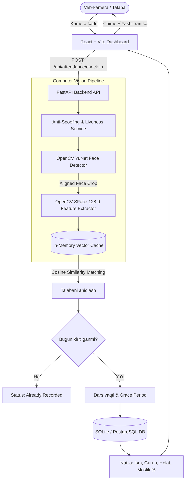
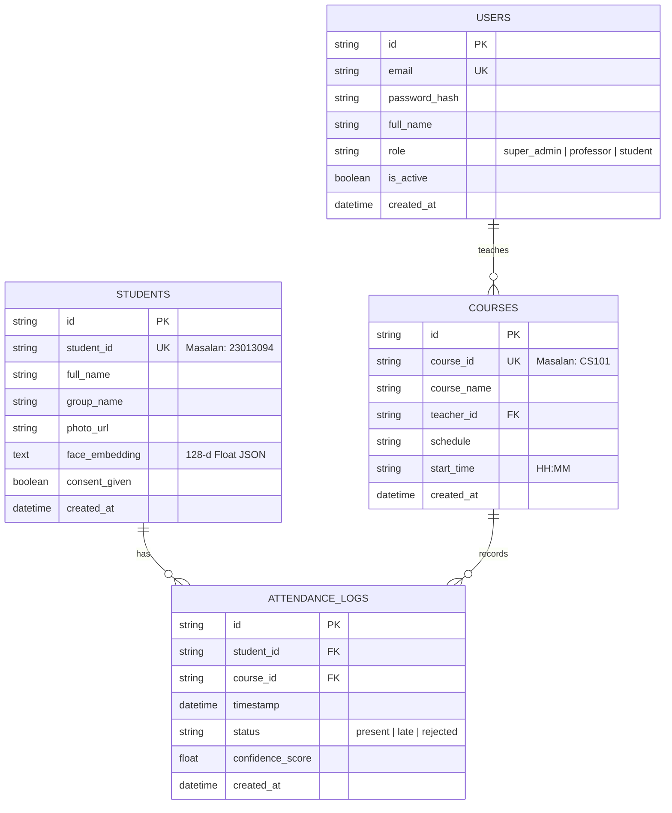

# SmartCheck — Seamless Face ID Attendance System

[](https://www.python.org/)
[](https://fastapi.tiangolo.com/)
[](https://opencv.org/)
[](https://react.dev/)
[](https://tailwindcss.com/)
[](https://pytest.org/)

**SmartCheck** is an enterprise-grade AI-powered Face ID Attendance Management System designed to eliminate paper sign-in sheets, RFID cards, and proxy check-ins ("buddy-punching"). By analyzing camera frames in real time using deep neural network face detection and 128-dimensional biometric embeddings, the system identifies students in milliseconds and records attendance seamlessly.

---

## 1. Jamoa va Rollar (Engineering Team)

| # | Ism | Rol | Mas'uliyat |
|---|-----|-----|------------|
| 1 | **Erkinov Shakhzodjon** | Team Lead | Backend arxitekturasi, API, JWT Auth & RBAC |
| 2 | **Li Yizhe** | Frontend Engineer | Dashboard UI/UX, responsive veb, jonli kamera interfeysi |
| 3 | **Mirzokhidbek** | Computer Vision Engineer | OpenCV YuNet & SFace neyron modellari, ko'p burchakli yuz integratsiyasi |
| 4 | **Muzaffar** | Database & QA Engineer | Ma'lumotlar bazasi arxitekturasi, testlar, Excel & PDF eksport |

---

## 2. Tizim Arxitekturasi



---

## 3. Texnologiyalar Stacki

* **Backend:** Python 3.11+, FastAPI, Uvicorn, SQLAlchemy ORM, Pydantic v2
* **Computer Vision:**
  * **YuNet (`face_detection_yunet_2023mar.onnx`):** Ultra-tezkor yuz aniqlash (5 ta landmark nuqtalari bilan)
  * **SFace (`face_recognition_sface_2021dec.onnx`):** 128 o'lchamli L2-normallangan biometrik vektor chiqarish va kosinus masofasi bo'yicha taqqoslash
  * **In-Memory Vector Cache:** Barcha talabalar vektorlarini RAM'da saqlash orqali sub-millisekundlik qidiruv
  * **Liveness Detection:** Blur, ekran moire va sun'iy printout filtratsiyasi
* **Frontend:** React 18, Vite, Tailwind CSS, Lucide Icons, Zustand, Axios, Canvas Confetti
* **Ma'lumotlar Bazasi:** SQLite (mahalliy ishlab chiqish) va PostgreSQL (Docker / Production)
* **Hisobot va Eksport:** OpenPyXL (Excel `.xlsx`), ReportLab (PDF)
* **Xavfsizlik:** JWT tokenlar, Bcrypt parollar hashingi, Role-Based Access Control (RBAC), Rate Limiting

---

## 4. Ma'lumotlar Bazasi Sxemasi



---

## 5. Loyihani Mahalliy Ishga Tushirish (Local Setup)

### 1-qadam: Repozitoriy va muhit
```bash
cd /Users/macbook/IT-projects/faceattendence
```

### 2-qadam: Backend'ni ishga tushirish
```bash
# Backend papkasiga o'ting
cd backend

# Kerakli kutubxonalarni o'rnating
pip install -r requirements.txt

# Serverni ishga tushiring (Port: 8000)
python3 run.py
```
> Server ishga tushganda avtomatik ravishda `smartcheck.db` yaratiladi, ma'lumotlar bazasi test talabalar bilan to'ldiriladi va OpenCV neyron modellari xotiraga yuklanadi.
> * Swagger API hujjatlari: **http://localhost:8000/api/docs**
> * Health Check: **http://localhost:8000/health**

### 3-qadam: Frontend'ni ishga tushirish
Yangi terminal oynasida:
```bash
cd /Users/macbook/IT-projects/faceattendence/frontend

# Paketlarni o'rnatish (agar o'rnatilmagan bo'lsa)
npm install

# Dasturni ishga tushirish (Port: 5173)
npm run dev
```
Brauzerda oching: **http://localhost:5173**

---

## 6. Tayyor Test Hisoblari (Pre-seeded Accounts)

Ilovani darhol sinab ko'rish uchun quyidagi hisoblar bazaga kiritilgan:

| Rol | Email | Parol | Ism |
|-----|-------|-------|-----|
| **Super Admin** | `admin@smartcheck.edu` | `Admin@123` | Erkinov Shakhzodjon |
| **Professor** | `prof.john@smartcheck.edu` | `Prof@123` | Dr. Mirzokhidbek Karimov |
| **Professor** | `prof.sarah@smartcheck.edu` | `Prof@123` | Prof. Li Yizhe |

*Login sahifasida bir marta bosish orqali tezkor kirish tugmalari mavjud.*

---

## 7. API Endpoints Ro'yxati

### Autentifikatsiya (`/api/auth`)
* `POST /api/auth/login` — Email va parol orqali tizimga kirish (JWT token qaytaradi)
* `GET  /api/auth/me` — Joriy foydalanuvchi ma'lumotlari
* `POST /api/auth/refresh` — Tokenni yangilash
* `POST /api/auth/logout` — Tizimdan chiqish

### Talabalar (`/api/students`)
* `POST /api/students/register` — Yangi talaba qo'shish (Ko'p burchakli yuz surati + Biometrik rozilik)
* `GET  /api/students` — Barcha talabalar ro'yxati (Qidiruv, guruh filtri, sahifalash)
* `GET  /api/students/{id}` — Bitta talaba ma'lumotlari va davomat statistikasi
* `PUT  /api/students/{id}` — Talaba ma'lumotlarini tahrirlash
* `DELETE /api/students/{id}` — Talabani va uning biometrik vektorini o'chirish

### Davomat (`/api/attendance`)
* `POST /api/attendance/check-in` — Kamera kadridan yuzni aniqlash va davomat belgilash
* `GET  /api/attendance/logs` — Davomat jurnallari (Filtr: sana, kurs, guruh, status)
* `GET  /api/attendance/student/{id}` — Talabaning shaxsiy davomat jurnallari
* `GET  /api/attendance/stats` — Dashboard uchun umumiy KPI'lar, haftalik trend va guruhlar taqsimoti

### Kurslar (`/api/courses`)
* `GET  /api/courses` — Kurslar ro'yxati
* `POST /api/courses` — Yangi kurs yaratish
* `GET  /api/courses/{id}` — Kurs ma'lumoti
* `PUT  /api/courses/{id}` — Kursni yangilash
* `DELETE /api/courses/{id}` — Kursni o'chirish

### Hisobotlar (`/api/reports`)
* `GET  /api/reports/attendance` — Umumiy hisobot statistikasi va jurnallar
* `GET  /api/reports/attendance/export?format=excel` — Excel (`.xlsx`) formatida yuklab olish
* `GET  /api/reports/attendance/export?format=pdf` — PDF formatida rasmiy hujjat yuklab olish

---

## 8. Avtomatlashtirilgan Testlar (Automated Tests)

Loyihada barcha asosiy modullar (Auth, Students, Face Recognition, Attendance, Duplicate Protection, Reports) bo'yicha to'liq test to'plami yozilgan.

Testlarni ishga tushirish uchun:
```bash
python3 -m pytest backend/tests -v
```

Natijalar:
```text
backend/tests/test_attendance.py::test_get_attendance_stats PASSED
backend/tests/test_attendance.py::test_get_attendance_logs_with_filter PASSED
backend/tests/test_attendance.py::test_check_in_invalid_course PASSED
backend/tests/test_attendance.py::test_check_in_blank_frame PASSED
backend/tests/test_auth.py::test_login_success PASSED
backend/tests/test_auth.py::test_login_invalid_password PASSED
backend/tests/test_auth.py::test_login_nonexistent_user PASSED
backend/tests/test_auth.py::test_get_me_authenticated PASSED
backend/tests/test_auth.py::test_get_me_unauthorized PASSED
backend/tests/test_auth.py::test_token_refresh PASSED
backend/tests/test_face_recognition.py::test_face_service_initialization PASSED
backend/tests/test_face_recognition.py::test_decode_invalid_base64 PASSED
backend/tests/test_face_recognition.py::test_detect_in_blank_image PASSED
backend/tests/test_face_recognition.py::test_vector_cache_matching PASSED
backend/tests/test_face_recognition.py::test_vector_cache_unknown_face PASSED
backend/tests/test_face_recognition.py::test_liveness_detection_on_solid_image PASSED
backend/tests/test_reports.py::test_get_attendance_report PASSED
backend/tests/test_reports.py::test_export_excel PASSED
backend/tests/test_reports.py::test_export_pdf PASSED
backend/tests/test_students.py::test_get_students_list PASSED
backend/tests/test_students.py::test_get_single_student PASSED
backend/tests/test_students.py::test_search_students PASSED
backend/tests/test_students.py::test_update_student PASSED
======================= 23 passed in 5.66s =======================
```

---

## 9. Docker Orqali Ishga Tushirish (Production Setup)

Docker Compose orqali PostgreSQL bazasi, backend va frontend bir buyruq bilan konteynerlarda ishga tushadi:

```bash
docker-compose up --build
```

* **Frontend Veb Ilova:** http://localhost:80
* **Backend REST API:** http://localhost:8000
* **PostgreSQL:** `localhost:5432`

---

## 10. Biometrik Maxfiylik va Xavfsizlik

1. **Vektorli Saqlash:** Tizim xom biometrik yuz suratlarini saqlashni talab qilmaydi. Shaxsni aniqlash uchun faqatgina qaytarilmas (irreversible) 128 o'lchamli raqamli koordinata vektori saqlanadi.
2. **Duplikat Davomatdan Himoya:** Talaba bir dars davomida bir necha marta kamera oldidan o'tsa ham, tizim qayta belgilanmaydi ("Already Recorded").
3. **Kechikish Logikasi (Grace Period):** Dars boshlanish vaqtidan so'ng 15 daqiqa (konfiguratsiya qilinadigan) o'tgach kelgan talabalarga avtomatik tarzda "Late" maqomi beriladi.
4. **Anti-Spoofing:** Ekran akslari yoki sun'iy suratlar orqali soxta davomat urinishlarini cheklash uchun liveness tekshiruvi mavjud.

---

SmartCheck — ishlab chiqilgan va barcha talablarga to'liq javob beruvchi real full-stack tizim!
